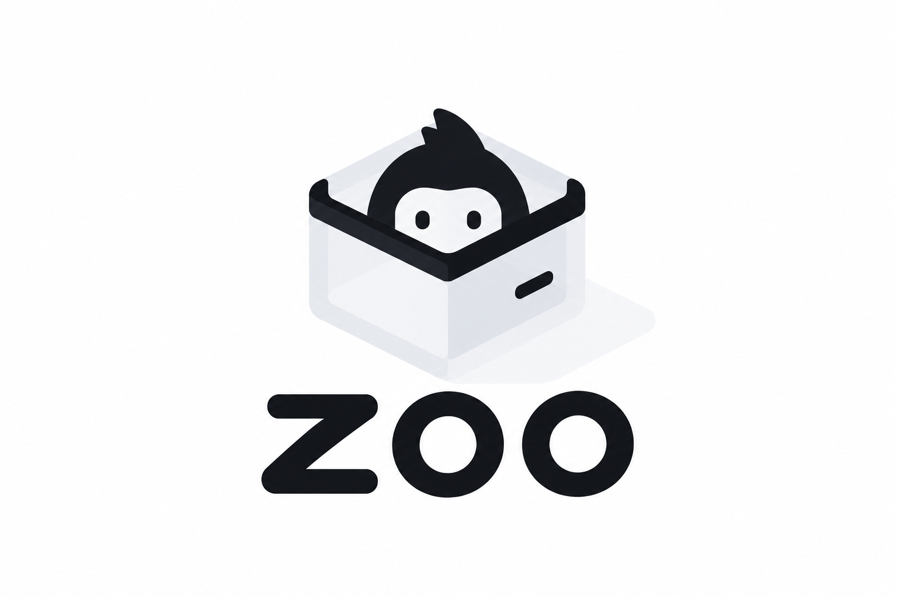

<p align="center">
  
</p>

<p align="center">
  Self-hosted sandboxes for AI agents.
</p>

<p align="center">
  <a href="https://github.com/chann44/zoo/releases/latest"></a>
  <a href="https://hub.docker.com/r/chann44/zoo-api"></a>
</p>

Run Linux, macOS and Windows sandboxes. Connect agents through MCP, REST or an SDK;
watch and control their desktops from your browser.

## Quickstart

Install on Debian/Ubuntu, macOS or Windows. Mac and Windows installations need
[Docker Desktop](https://www.docker.com/products/docker-desktop/) running.

**Linux / macOS**

```bash
curl -fsSL https://github.com/chann44/zoo/releases/latest/download/install.sh | sudo bash -s -- --admin-email you@example.com
```

**Windows** — run PowerShell as administrator:

```powershell
powershell -ExecutionPolicy Bypass -c "& ([scriptblock]::Create((irm https://github.com/chann44/zoo/releases/latest/download/install.ps1))) -AdminEmail 'you@example.com'"
```

Open the dashboard URL the installer prints. Sign in with the printed credentials
or create an account, then create a sandbox. Add more hosts under **Remote Servers**.

Linux desktop, Firefox browser and code sandboxes use a Linux Docker engine.
Native macOS sandboxes require Apple Silicon; Windows sandboxes require Hyper-V.

## Connect an agent

Copy the dashboard's MCP configuration into your agent client, or use the CLI:

```bash
pip install 'zoo-sdk[cli]'
zoo login
zoo create --kind desktop
zoo ls
```

SDKs: [Python](sdk/python/README.md) · [TypeScript](sdk/typescript/README.md) · [React](sdk/react/README.md)

## Documentation

[Quickstart](site/src/content/docs/docs/get-started/quickstart.md) ·
[Installation](site/src/content/docs/docs/get-started/install.md) ·
[MCP setup](site/src/content/docs/docs/get-started/mcp.md) ·
[All docs](site/src/content/docs/docs/index.mdx)

[Development](docs/development.md) · [Components](docs/components.mmd) ·
[Architecture](docs/architecture-map.md) · [Security](SECURITY.md)
